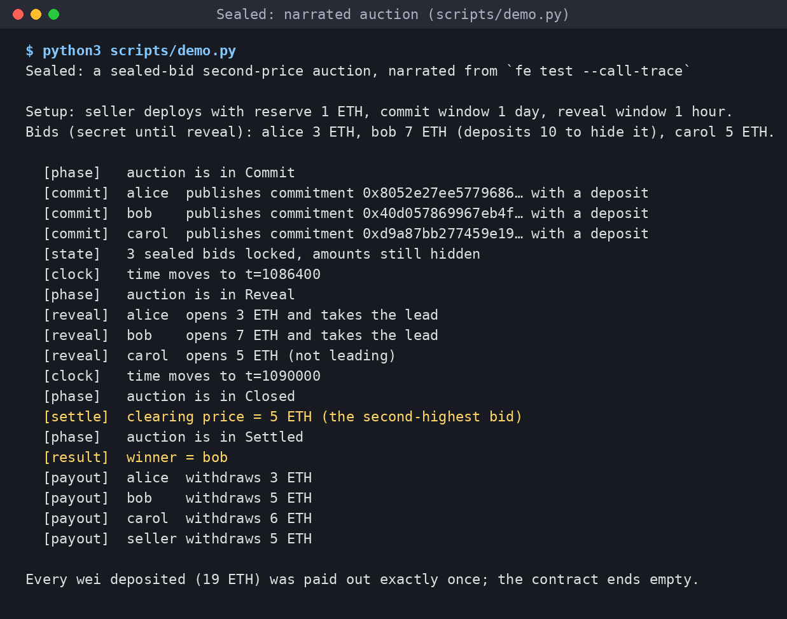

# Sealed

**Pitch:** A sealed-bid second-price (Vickrey) auction in Fe where money, time,
commitments and auction phases are distinct types and "now" is an effect, so
the classic auction bugs either fail to compile or are pinned down by 58
tests, at gas parity with optimised Solidity, all run locally with `fe test`
and no deployment.

Built for the [Fe Builders Challenge](https://fe-lang.org/contest/) (project
FE-005) by Pasha Meer.

## The problem

On-chain auctions leak. In an open English auction every bid is public, so
bidders snipe in the last block and searchers front-run. The textbook fix is a
**sealed-bid second-price auction** (Vickrey): everyone submits one hidden bid,
the highest bidder wins and pays the *second-highest* bid. Bidding your true
value is then the best strategy, which is why Vickrey auctions are used for
ad slots, spectrum and ENS-style name sales.

On a public chain "hidden" means **commit-reveal**: publish a hash, reveal the
bid later. That makes the contract a small state machine over time, and it is
easy to get wrong:

- comparing a deadline with an amount, or adding two deadlines, because
  everything is a `uint256`;
- accepting a reveal in the commit window, or a commit after it closed;
- letting someone replay another bidder's commitment hash;
- double refunds, or refunds before the outcome is fixed;
- letting bidders commit and then "forget" to reveal losing bids for free;
- tests that can't reach the reveal phase without chain cheat codes.

## Approach

Sealed encodes the protocol's rules in Fe's type and effect system, and keeps
the auction mathematics as pure values that can be tested exhaustively.

- **Typed units.** Amounts are `Wei`, instants `Timestamp`, spans `Duration`
  (Fe 26.5 std). `Timestamp + Duration` is a `Timestamp`;
  `Timestamp + Timestamp` and `Wei + Duration` don't compile.
- **Newtypes.** A `Commitment(u256)` tuple struct can only be built with
  `Commitment::of(auction, bidder, amount, salt)`, which binds the auction
  address and the bidder, so a copied hash can't be opened by anyone else.
- **Phase as an enum, computed from the clock.** `Commit → Reveal → Closed →
  Settled` is derived from a `Schedule` and the current time, never stored as a
  flag someone forgets to flip. A `match` that misses a phase is rejected.
- **Time is an effect.** All transitions declare `uses (clock: Clock, store:
  mut AuctionStore)`. The deployed contract provides the block clock; tests
  provide any clock they like with `with (Clock = ...)`. The test harness
  moves time without a single cheat code, and read-only code that tries to call
  a transition is a compile error (`settle` requires `mut AuctionStore`).
- **Pull payments with a forfeit rule.** After settlement each account pulls
  its own payout: losers get their deposit back, the winner gets
  `deposit − price`, the seller gets `price + forfeited deposits`. Bidders who
  never reveal forfeit to the seller, which removes the free option of
  committing several bids and revealing only the convenient one.
- **Deposits hide bids.** A bidder may deposit more than they bid, so the
  deposit does not reveal the bid.

### What was built during the contest

Everything in `src/`, `compile_fail/`, `scripts/` and this README, starting
from the official starter repository (see Declaration).

## Fe highlight

**Time as a trait-keyed effect.** The auction logic never reads the block. It
says it needs a `Clock`, and whoever calls it decides what "now" is:

```fe
// src/types.fe
pub trait Clock {
    fn now(self) -> Timestamp
}

pub fn current_phase(schedule: Schedule, settled: bool) -> Phase uses (clock: Clock) {
    if settled { Phase::Settled } else { schedule.phase_at(clock.now()) }
}

// src/auction.fe — one implementation of the rules
pub fn reveal(auction: Address, bidder: Address, amount: Wei, salt: u256) -> bool
    uses (clock: Clock, store: mut AuctionStore)
{
    require_phase(Phase::Reveal)
    ...
}

// src/sealed.fe — the deployed contract uses the block's clock
Reveal { amount, salt } -> bool uses (ctx, mut store, mut log) {
    let leading = with (Clock = FixedClock { at: ctx.timestamp() }, store) {
        reveal(auction: ctx.address(), bidder: ctx.caller(), amount, salt)
    }
    ...
}

// src/tests/harness.fe — the test harness runs the *same* function with a
// clock it can move
Reveal { amount, salt } -> bool uses (ctx, mut store, now) {
    with (Clock = FixedClock { at: now }, store) {
        reveal(auction: ctx.address(), bidder: ctx.caller(), amount, salt)
    }
}
```

Forgetting to provide a clock is a compile error (`missing effect Clock`), and
because units are types, the schedule can only be built one way:

```fe
pub fn starting(at: Timestamp, commit_period: Duration, reveal_period: Duration) -> Schedule {
    let commit_end = at + commit_period          // Timestamp + Duration = Timestamp
    Schedule { commit_end, reveal_end: commit_end + reveal_period }
}
// s.commit_end + s.reveal_end  → error: expected `Duration`, but `Timestamp` is given
```

The `compile_fail/` directory holds six tiny ingots that each make one classic
mistake against the real library; `scripts/compile-fail.sh` (run in CI)
checks that every one is rejected with the expected error.

## Architecture

```
src/
├── types.fe     Commitment(u256), Settlement(u256), Phase, Schedule, Clock + FixedClock
├── book.fe      Book (highest, second, winner): the second-price rule and payouts, pure
├── auction.fe   AuctionStore + transitions: commit, reveal, settle, take_payout
│                (uses Clock + storage effects; Solidity-style custom errors)
├── sealed.fe    SealedAuction contract: ABI, events, ETH transfers, block clock
└── tests/
    ├── unit.fe        schedule boundaries, commitment hashing, the Book, payouts
    ├── harness.fe     TimedAuction (same rules, movable clock) + Bidder accounts
    ├── lifecycle.fe   full auctions and every failure path, by exact error selector
    ├── properties.fe  randomised auctions (KeccakRng) + pinned cases (ReplayRng)
    └── deployed.fe    the real SealedAuction with the block clock
compile_fail/          six ingots that must NOT compile (typed-unit and effect misuse)
bench/                 Solidity reference, gas.py (py-evm), RESULTS.md
scripts/compile-fail.sh, scripts/demo.py
```

Flow of one auction:

```
 seller: deploy(commit_period, reveal_period, reserve)
          │
 Commit   │  bidder: commit(keccak256(abi.encode(auction, bidder, amount, salt)))  + deposit ≥ amount
          ▼  (now < commit_end)
 Reveal   │  bidder: reveal(amount, salt)  → Book.record(bidder, amount)
          ▼  (commit_end ≤ now < reveal_end)
 Closed   │  anyone: settle()  → price = max(second, reserve), or 0 if highest < reserve
          ▼
 Settled  │  each account: withdraw(to)  → loser: deposit · winner: deposit − price
                                           unrevealed: 0 · seller: price + forfeits
```

The `Book` keeps only the top two bids, so reveal and settlement cost the same
for 2 or 2,000 bidders, and no loop over bidders exists anywhere.

ABI (Solidity-compatible selectors): `commit(uint256)` (payable),
`reveal(uint256,uint256)`, `settle()`, `withdraw(address)`, and views
`phase()`, `winner()`, `price()`, `highestBid()`, `claimable(address)`,
`commitmentOf(address)`, `depositOf(address)`, `bidders()`, `reveals()`,
`commitEnd()`, `revealEnd()`, `seller()`, `reserve()`. Events: `Committed`,
`Revealed`, `Settled`, `Withdrawn`. Errors: `WrongPhase(uint8,uint8)`,
`AlreadyCommitted(address)`, `EmptyCommit()`, `SellerCannotBid()`,
`NoCommitment(address)`, `CommitmentMismatch()`, `AlreadyRevealed()`,
`InvalidBid(uint256,uint256)`, `NothingToWithdraw()`.

## Build and test

```sh
# Fe 26.5.0 (any release >= 26.5.0 is allowed by the contest)
curl -fsSL https://raw.githubusercontent.com/argotorg/fe/master/feup/feup.sh | bash -s -- --version v26.5.0
fe --version              # fe 26.5.0 (3dab95f)

fe test                   # 58 tests
fe build                  # writes out/SealedAuction.{bin,runtime.bin,abi.json}
./scripts/compile-fail.sh # 6 classic bugs, each rejected by the compiler
python3 scripts/demo.py   # narrated auction (needs Python 3, stdlib only)

# gas comparison (needs solc 0.8.28 on PATH)
pip install -r bench/requirements.txt
python3 bench/gas.py
```

CI (`.github/workflows/ci.yml`) runs `fe fmt --check`, `fe test`, `fe build`
and the compile-fail check on every push, and a second job reruns the gas
comparison and posts the table to the run summary.

### Test coverage

| File | Tests | What |
| --- | --- | --- |
| `unit.fe` | 19 | half-open phase boundaries, zero-length windows, countdowns, `Clock` effect, commitment = `keccak256(abi.encode(...))` test vector, every Book case (order independence, ties, reserve above/below/equal), payout conservation, the one-word `Settlement` encoding |
| `lifecycle.fe` | 29 | full 3-bidder auction, forfeits, no sale, no bids, single bidder, lone bidder winning for free, ties, last-second commit/reveal, and each failure path asserted by its exact custom-error selector |
| `properties.fe` | 3 | 12 random 5-bidder auctions (`KeccakRng`), plus all-equal-bids and nobody-reveals pinned with `ReplayRng`: winner, price and conservation of every wei |
| `deployed.fe` | 7 | the real contract with the block clock: constructor, commit storage, phase guards, empty auction |

## Gas: Fe vs. Solidity

`bench/SealedAuction.sol` is the same auction written in idiomatic Solidity
(same ABI, rules, errors and events). `bench/gas.py` deploys both on py-evm
(Cancun rules) and plays the three-bidder auction from the demo with real
signed transactions and block timestamps, asserting the same payouts on both.
Gas used per transaction (intrinsic gas included):

| Transaction | Fe -O1 | Fe -O2 | solc | solc via-IR | Fe -O2 vs best solc |
| --- | ---: | ---: | ---: | ---: | ---: |
| deploy | 653,619 | 653,187 | 736,434 | 694,976 | -6.0% |
| commit (first bidder) | 118,961 | 118,961 | 118,955 | 118,938 | +0.0% |
| commit | 84,761 | 84,761 | 84,755 | 84,738 | +0.0% |
| commit (3rd) | 84,761 | 84,761 | 84,755 | 84,738 | +0.0% |
| reveal (first, leads) | 147,498 | 147,498 | 146,222 | 145,951 | +1.1% |
| reveal (takes the lead) | 99,031 | 99,031 | 97,833 | 97,574 | +1.5% |
| reveal (not leading) | 76,343 | 76,343 | 74,699 | 74,443 | +2.6% |
| settle | 62,912 | 62,912 | 66,394 | 66,020 | -4.7% |
| withdraw (loser) | 97,408 | 97,400 | 95,706 | 95,326 | +2.2% |
| withdraw (winner) | 97,434 | 97,426 | 97,891 | 97,491 | -0.1% |
| withdraw (loser, over-deposit) | 97,408 | 97,400 | 95,706 | 95,326 | +2.2% |
| withdraw (seller) | 88,779 | 88,771 | 91,216 | 90,959 | -2.4% |
| **all 11 auction txs** | **1,055,296** | **1,055,264** | **1,054,132** | **1,051,504** | **+0.4%** |
| init code size (bytes) | 2,451 | 2,449 | 2,920 | 2,729 | |

Fe is **at parity overall (+0.4% over the best solc pipeline across the
auction, 6% cheaper to deploy, 10% smaller init code than via-IR)**: cheaper to settle and
for the winner and seller to withdraw, 1–3% dearer on reveals and loser
refunds.

What the benchmark taught us (useful for any Fe contract): the first version
was **+5.5% overall and +29% on `settle`**. Two Fe-level changes closed the
gap:

1. *One word, one type.* `settled: bool` plus `price: Wei` meant two fresh
   20,000-gas `SSTORE`s at settlement (Solidity packs the bool into a shared
   slot for free). `Settlement(u256)` stores `price + 1` in one word, with the
   encoding private to the newtype, so it costs one `SSTORE` and stays
   impossible to misuse.
2. *Don't copy storage structs on hot paths.* Calling a method on
   `store.schedule` loads every field of the struct; the phase check now
   tests settlement first and reads `commit_end` / `reveal_end` individually,
   so a commit touches one deadline slot and calls after settlement touch none.

## Demo

Reproducible CLI demo, narrated from Fe's own `--call-trace` of the
three-bidder test (screenshots: [docs/demo.png](docs/demo.png) and
[docs/tests.png](docs/tests.png), the latter showing `fe test`, a
compile error and the compile-fail check):



```text
$ python3 scripts/demo.py
Sealed: a sealed-bid second-price auction, narrated from `fe test --call-trace`

Setup: seller deploys with reserve 1 ETH, commit window 1 day, reveal window 1 hour.
Bids (secret until reveal): alice 3 ETH, bob 7 ETH (deposits 10 to hide it), carol 5 ETH.

  [phase]   auction is in Commit
  [commit]  alice  publishes commitment 0x8052e27ee5779686… with a deposit
  [commit]  bob    publishes commitment 0x40d057869967eb4f… with a deposit
  [commit]  carol  publishes commitment 0xd9a87bb277459e19… with a deposit
  [state]   3 sealed bids locked, amounts still hidden
  [clock]   time moves to t=1086400
  [phase]   auction is in Reveal
  [reveal]  alice  opens 3 ETH and takes the lead
  [reveal]  bob    opens 7 ETH and takes the lead
  [reveal]  carol  opens 5 ETH (not leading)
  [clock]   time moves to t=1090000
  [phase]   auction is in Closed
  [settle]  clearing price = 5 ETH (the second-highest bid)
  [phase]   auction is in Settled
  [result]  winner = bob
  [payout]  alice  withdraws 3 ETH
  [payout]  bob    withdraws 5 ETH
  [payout]  carol  withdraws 6 ETH
  [payout]  seller withdraws 5 ETH

Every wei deposited (19 ETH) was paid out exactly once; the contract ends empty.
```

## Limitations

- **Bid privacy is commit-reveal privacy.** Amounts are hidden until reveal,
  but the deposit is public, so it is an upper bound on the bid. Bidders who
  care should over-deposit. Participation itself is public.
- **Unrevealed deposits are forfeited to the seller.** That is deliberate (it
  removes the free option of selective revealing) but it is harsh on bidders
  who simply miss the window, and a seller could try to censor reveals with
  enough block-builder power near the deadline. Reveal windows should be long.
- **Ties** go to the first revealer, who pays their own (equal) bid.
- **One item, one bid per account.** A bidder can't update a commitment; Sybil
  accounts are possible as in any permissionless auction.
- **No item custody.** The contract settles payment only; delivering the item
  (an NFT transfer, a name registration) would be an extension that calls out
  on settlement.
- **Block timestamps** are trusted to within the usual few seconds of proposer
  freedom.
- Payouts are sent with the 2,300-gas stipend (`send_value` with `gas: 0`),
  so a recipient contract with an expensive `receive` can't take ETH; the
  `withdraw(to)` argument lets such an account pick another recipient. (The
  gas benchmark found that sending to a precompile address fails this way.)
- `fe build` also emits the test-only `TimedAuction` and `Bidder` contracts;
  only `SealedAuction` is meant to be deployed.
- Not audited. Not deployed anywhere: everything runs on Fe's local test EVM.

## Declaration

- **Pre-existing work:** The repository starts from the official
  [`fe-lang/builders-challenge-starter`](https://github.com/fe-lang/builders-challenge-starter)
  at commit `f9d9aa9` (its history is kept; its example vault contract and
  tests were removed). The project idea and a written plan existed before
  November 3, 2026; no project code did. All code in this repository was
  written from November 3, 2026 onward.
- **Third-party code:** None copied. The project uses the Fe standard library
  (`std::evm` units, `keccak_words`, `random`, `StorageMap`), the starter's CI
  workflow and Apache-2.0 licence. `scripts/demo.py` uses only the Python
  standard library; `bench/gas.py` uses py-evm (MIT) and solc (GPL-3.0, run
  as a tool only). The Solidity reference contract was written for this
  project.
- **AI assistance:** Written with substantial help from an AI assistant
  (Hark), which drafted code, tests and documentation under Pasha Meer's
  direction. Every claim here is backed by tests that run in CI; Pasha Meer is
  the responsible human contact and can explain and defend the design.

## Team

Pasha Meer (solo) — GitHub [@meerpasha59-bit](https://github.com/meerpasha59-bit).

## License

[Apache-2.0](LICENSE).
